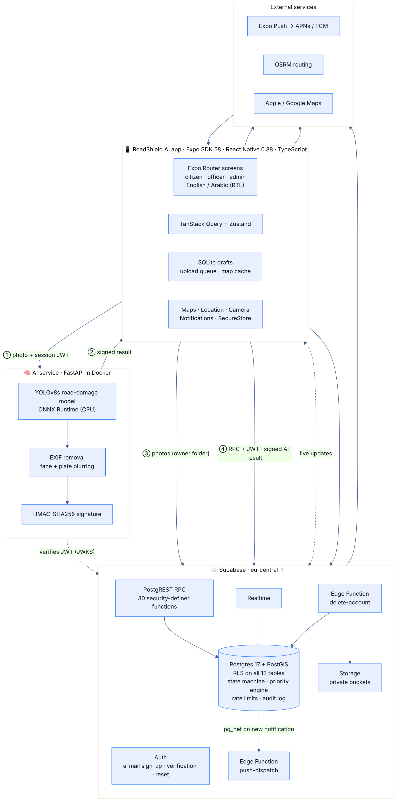

# RoadShield AI

**Safer Roads. Smarter Cities.** · **طرق أكثر أمانًا. مدن أذكى.**

A native iOS and Android app for reporting, verifying and repairing road hazards. Citizens
photograph road damage and get a suggestion from a trained detection model; the city verifies
reports, and maintenance crews work them by priority. English and Arabic (right-to-left).



## What's inside

| Part | Stack | Folder |
|---|---|---|
| Mobile app | Expo SDK 58 · React Native 0.88 · TypeScript (strict) · Expo Router · NativeWind · Reanimated 4 · react-native-maps · TanStack Query · Zustand · React Hook Form + Zod · expo-sqlite · expo-secure-store | `src/` |
| Backend | Supabase: Postgres 17 + PostGIS, Auth, Storage, Realtime, Edge Functions | `supabase/` |
| AI service | FastAPI · ONNX Runtime · YOLOv8s trained on RDD2022 · OpenCV face/plate redaction | `services/ai/` |
| Docs | SRS, design (UML, ERD), API, testing, deployment | `docs/` |

### Features
- **Citizens**: animated onboarding; e-mail sign-up with verification, password reset, profile
  photo, account deletion; home dashboard with nearby verified hazards and personal stats; live map
  with clustering, severity colours, filters, search, satellite mode and bottom sheets; AI-assisted
  multi-step reporting with GPS or manual pin, duplicate suggestions, offline drafts and
  auto-sync; report timeline; route safety assistant with hazard counts and exposure per route,
  plus foreground warnings (banner, haptics, optional voice); notifications; saved places;
  dark/light theme.
- **Maintenance officers**: priority work queue with search and filters, claim and update tasks,
  before/after photos, repair notes, completion requests, history.
- **Admins**: analytics (totals, resolution time, trends, by category and region, workload,
  priority mix and heatmap), moderation (verify, reject, duplicate, photo privacy approval,
  traffic exposure), user and role management, suspensions, bilingual announcements, audit log.

### Integrity rules the system enforces
- AI results come only from the trained model and are **cryptographically signed**; the database
  rejects forged, edited or borrowed results. Without the AI service: *"AI analysis unavailable —
  continue manually."*
- Only **verified** hazards are public; photos are public only after **privacy approval**; EXIF/GPS
  metadata is stripped; faces and plates are blurred where detectable.
- Statistics, routes, ETAs and priorities are computed from real data. The priority score is labelled
  as **not** an accident prediction, and route screens say hazard data may be incomplete.

## Status (31 Oct 2026)

| | |
|---|---|
| ✅ Supabase backend live | project `roadshield-ai` (`vdfvoxvkxicemgqrsxjh`), 14 migrations, 42/42 security tests passing on the live database |
| ✅ App code | typecheck clean · 106 Jest tests · Android and iOS bundles build · `expo prebuild` generates both native projects |
| ✅ AI service | 33 tests · real YOLOv8s model verified on real photos · signed result accepted by the live database |
| ⏳ APK / AAB / IPA | needs your Expo account (and Apple Developer account for iOS). Follow [docs/DEPLOYMENT.md](docs/DEPLOYMENT.md) §3–5. No binary has been built yet. |
| ⏳ AI hosting | deploy `services/ai` (Docker) and set `EXPO_PUBLIC_AI_API_URL` |

## Quick start (development)

```bash
npm ci
cp .env.example .env          # Supabase URL + publishable key are already filled in
npx expo start --dev-client   # needs a development build:
eas build --profile development --platform android   # or ios
```

Expo Go cannot run this app because it uses native modules (maps, SQLite, secure store,
background location). Use a development build.

Tests:
```bash
npm run typecheck && npm test && npm run bundle:check
cd services/ai && python -m pytest -q
```

## Release builds

```bash
eas build --platform android --profile preview      # installable APK
eas build --platform ios --profile preview          # ad hoc IPA for registered iPhones
eas build --platform all --profile production       # Play Store AAB + App Store/TestFlight IPA
```
Full setup (accounts, signing, push credentials, Maps key, store submission):
[docs/DEPLOYMENT.md](docs/DEPLOYMENT.md).

## Documentation
- [Software Requirements Specification](docs/SRS.md): functional and non-functional requirements with traceability
- [Software Design](docs/DESIGN.md): architecture, use case, class, activity, sequence, state and ER diagrams, priority engine, design system
- [API reference](docs/API.md): RPCs, Edge Functions, AI service, error codes
- [Testing](docs/TESTING.md): strategy, catalogue, results, manual device checklist
- [Deployment](docs/DEPLOYMENT.md): backend, AI service, EAS builds, store submission
- Evidence: [docs/test-results/](docs/test-results/)

## Project structure
```
src/app/         screens (Expo Router)       src/lib/        API, AI client, offline, i18n, priority, geo
src/components/  UI kit, map, charts         src/stores/     session, settings, network
supabase/        migrations, functions, tests
services/ai/     FastAPI service, tests, training/export/evaluation scripts, Dockerfile
__tests__/       unit, component, integration tests
docs/            documentation and diagrams
```

## Credits & licences
App, backend and docs: MIT (`LICENSE`). AI service: AGPL-3.0 (`services/ai/LICENSE`), because it
serves Ultralytics YOLOv8 weights. Detection weights: YOLOv8s trained on RDD2022 (Japan + India)
by [oracl4/RoadDamageDetection](https://github.com/oracl4/RoadDamageDetection). Dataset: RDD2022,
Arya et al. (CC BY-SA 4.0). Face detector: OpenCV ResNet-10 SSD sample model. Map data © Apple /
Google; routing © OSRM / OpenStreetMap contributors.
