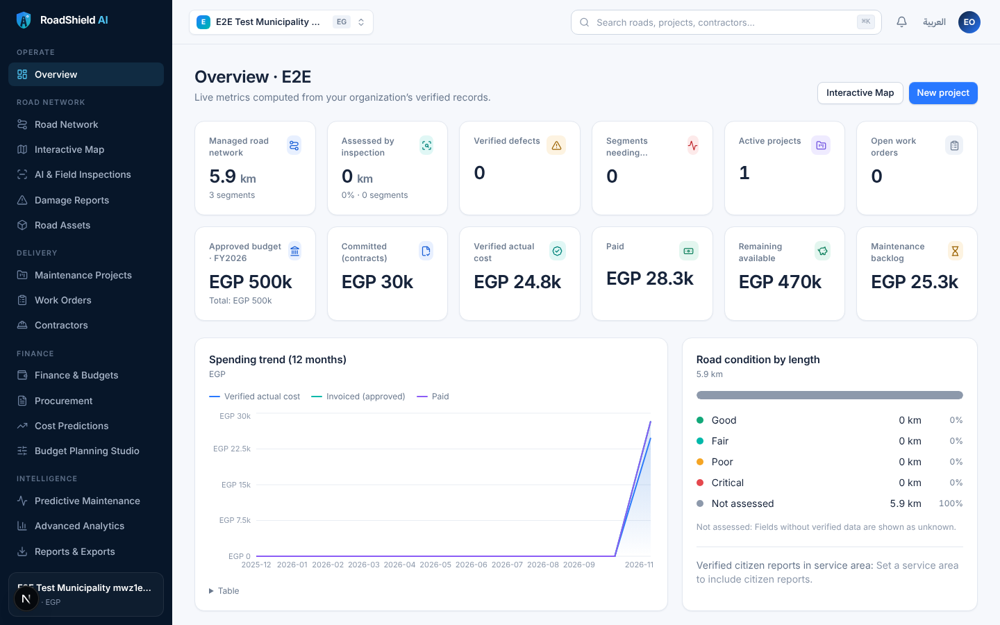

# RoadShield AI

**Detect. Predict. Budget. Repair. Optimize.** · **اكتشف. تنبّأ. خطّط الميزانية. أصلِح. حسِّن.**

RoadShield AI is a road-infrastructure intelligence platform for municipalities, road authorities,
engineering firms and contractors. Citizens and inspectors report road damage. Engineers verify it
with measurements. Projects, contracts and work orders deliver repairs. A financial ledger keeps
budget, commitment, invoiced, verified actual cost and payments strictly apart. English and Arabic
(right-to-left) throughout.

| Product | Stack | Folder |
|---|---|---|
| **RoadShield iOS & Android** | Expo SDK 58 · React Native 0.88 · Expo Router · native camera, GPS, notifications, SQLite offline queue | `src/` |
| **RoadShield Web & RoadShield OS** | Next.js 16 · TypeScript · Tailwind CSS 4 · MapLibre GL · Recharts | `apps/web/` |
| Backend | Supabase: Postgres 17 + PostGIS, Auth, Storage, RLS, `SECURITY DEFINER` RPCs | `supabase/` |
| RoadShield Vision | FastAPI · ONNX Runtime · face/plate redaction · signed results | `services/ai/` |
| RoadShield Finance AI | Explainable comparables estimator (SQL) + scikit-learn training with chronological validation | `supabase/`, `services/cost-intelligence/` |
| ML pipelines | RDD2022 download/preparation, torchvision Faster R-CNN training/evaluation, Colab notebook | `ml/` |



## What works today

* **Website**: home, platform, Vision, Finance AI, predictive maintenance, solutions (government,
  contractors), technology, security, pricing/quote, about, contact and demo request (stored in the
  database, rate-limited). EN/AR, SEO metadata, Open Graph image, sitemap.
* **RoadShield OS**, with every number computed from records:
  * **Monitoring:** overview KPIs, MapLibre road-condition map with a Road Intelligence panel, road
    detail (unknown fields stay unknown), OpenStreetMap GeoJSON import.
  * **Field work:** inspection review, citizen reports in the service area, asset register.
  * **Delivery:** projects with full financials, estimates from verified unit rates, contracts and
    change orders, work orders, actual costs, invoices and payments.
  * **Finance:** approval queue with four-eyes, unit-rate library, procurement, cost prediction
    (with "insufficient verified data" when appropriate), Budget Planning Studio (4 strategies),
    contractors.
  * **Analysis and admin:** analytics, predictive-maintenance flags, CSV exports, AI Model Center,
    organization settings, members and invitations, audit log, settings, global search (⌘K).
* **Multi-tenant SaaS**:
  * Organizations with six roles (owner, finance manager, road engineer, field inspector,
    contractor, executive viewer) plus platform admin.
  * Hashed one-time invitations; plans with quotas; usage metering; per-org audit.
  * Tenant isolation enforced by row-level security.
* **Mobile**:
  * The existing citizen app (AI-assisted reporting, map, timeline, notifications, offline drafts)
    and the maintenance-officer queue.
  * New **Field mode** for engineers, inspectors and contractors: measured inspections with GPS,
    work orders, progress logs with evidence photos, and cost submission, through an idempotent
    offline outbox.

Not yet done, and stated plainly in the docs: the live Supabase project is paused, so the new
migrations aren't applied there yet. The real New Damietta OSM import, RDD2022 training on a GPU,
and on-device testing of Field mode are pending. See
[docs/TEST_REPORT.md](docs/TEST_REPORT.md) and [docs/IMPLEMENTATION_CHECKLIST.md](docs/IMPLEMENTATION_CHECKLIST.md).

## Integrity rules

* No invented data: empty states instead of fake numbers; unit rates must be cited and verified by
  a second person; tender values can never be recorded as actual costs.
* Money is `numeric` in Postgres. Clients send decimal strings. Each project has one currency, with
  no silent FX.
* Four-eyes approvals; invoices are capped by commitments and payments by invoices; every financial
  action is audited.
* AI results come only from the model and are signed. The production detector is labelled
  *third-party pretrained* and its mAP is marked *not measured*.

## Quick start

```bash
# Database (local PostGIS) + both SQL suites
PGHOST=localhost PGUSER=postgres PGPASSWORD=postgres supabase/local/reset_local_db.sh roadshield_local

# Web
cd apps/web && npm ci && npm run dev          # see docs/SETUP.md for env + the dev gateway

# Mobile
npm ci && npx expo start --dev-client
```

## Tests (27 Nov 2026)

SQL 42/42 + 66/66 · web E2E 30/30 · responsive matrix 120/120 · web unit 8/8 · mobile Jest 108/108 ·
AI service 33/33 · ML 9/9 · cost pipeline 3/3 · GitHub Actions *CI* and *Web + database* green.
Details: [docs/TEST_REPORT.md](docs/TEST_REPORT.md).

## Documentation

[ARCHITECTURE](docs/ARCHITECTURE.md) · [SETUP](docs/SETUP.md) · [DEPLOYMENT](docs/DEPLOYMENT.md) ·
[DATA_SOURCES](docs/DATA_SOURCES.md) · [FINANCIAL_MODEL](docs/FINANCIAL_MODEL.md) ·
[MODEL_CARD](docs/MODEL_CARD.md) · [TRAINING_REPORT](docs/TRAINING_REPORT.md) ·
[SECURITY](docs/SECURITY.md) · [TEST_REPORT](docs/TEST_REPORT.md) · [API](docs/API.md) ·
[SRS](docs/SRS.md) · [DESIGN](docs/DESIGN.md)

## Credits & licences

App, web, backend and docs: MIT (`LICENSE`). AI inference service: AGPL-3.0 (`services/ai/LICENSE`),
because it serves Ultralytics YOLOv8 weights by
[oracl4/RoadDamageDetection](https://github.com/oracl4/RoadDamageDetection). The new training
pipeline uses torchvision (BSD-3-Clause). Dataset: RDD2022, Arya et al. (CC BY-SA 4.0). Map data ©
OpenStreetMap contributors (ODbL); basemap tiles by OpenFreeMap / OpenMapTiles.
