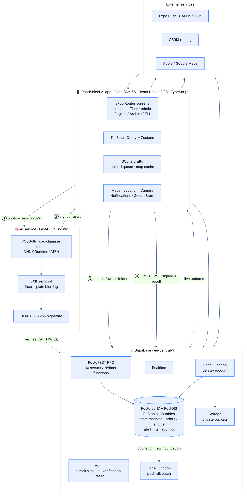
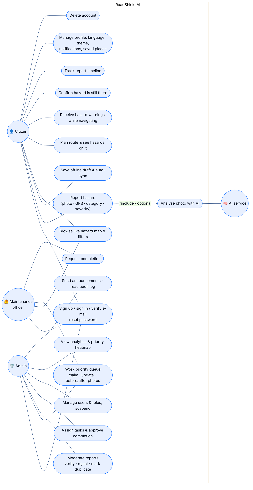
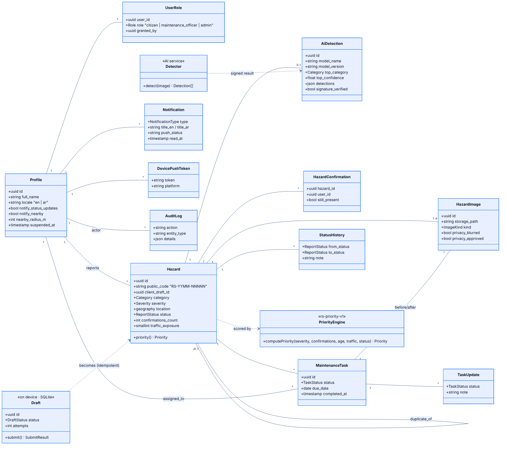
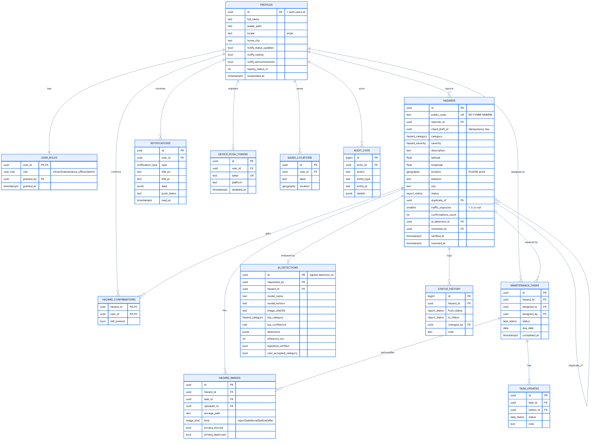
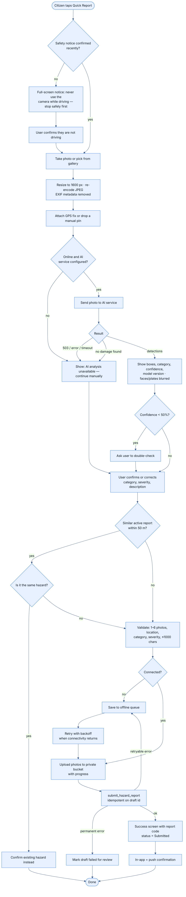
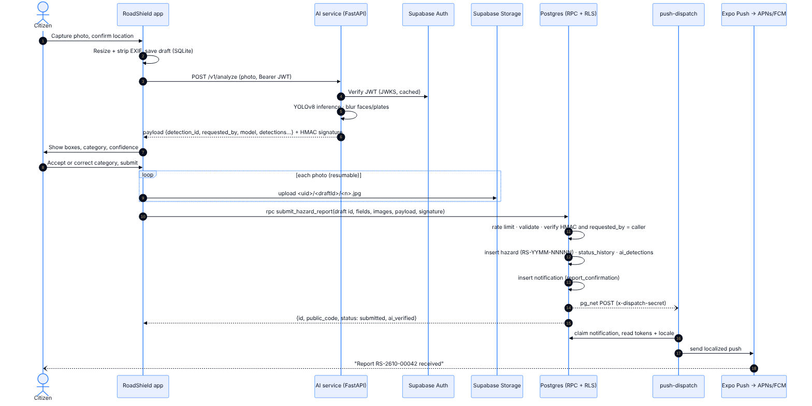
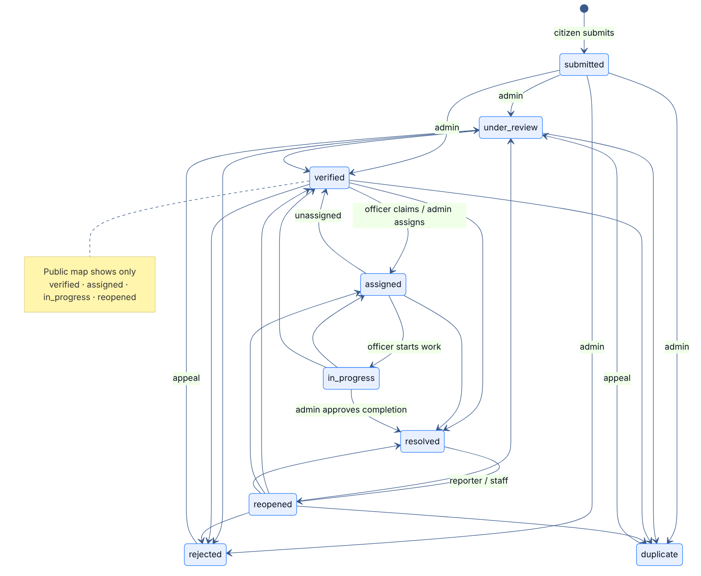

# RoadShield AI — Software Design

All diagrams are Mermaid sources in `docs/diagrams/*.mmd`, rendered to `.svg` (for documents) and
`.png` at 2× (for slides). Re-render after editing:

```bash
npx -y @mermaid-js/mermaid-cli -i docs/diagrams/erd.mmd -o docs/diagrams/erd.svg -b white
```

## 1. Architecture



| Layer | Technology | Responsibility |
|---|---|---|
| Mobile app | Expo SDK 58, React Native 0.88 (New Architecture), TypeScript strict, Expo Router, NativeWind, Reanimated 4, Gesture Handler, react-native-maps, TanStack Query, Zustand, React Hook Form + Zod, expo-sqlite, expo-secure-store | UI, offline drafts and queue, caching, device features |
| Backend | Supabase: Postgres 17 + PostGIS, Auth, Storage, Realtime, Edge Functions (Deno), pg_net | Data, **all business rules and permission checks**, notifications |
| AI | FastAPI, ONNX Runtime, OpenCV, YOLOv8s trained on RDD2022 | Detection, privacy redaction, signed results |
| External | Expo Push (APNs/FCM), OSRM routing, Apple/Google Maps | Push delivery, routes, turn-by-turn hand-off |

**Key decisions**

1. **Thick database, thin client.** Every write goes through a `security definer` RPC that checks
   `auth.uid()`, role, input and state transitions. Tables have RLS and the `authenticated` role has
   no direct INSERT/UPDATE on business tables. The app's role checks are only for showing the right
   UI; the server re-checks everything.
2. **Signed AI results.** The client never writes AI results. The AI service signs a canonical JSON
   payload (including the caller's user id) with HMAC-SHA256. `submit_hazard_report` recomputes the
   HMAC with a secret only the database and the AI service know, and stores the detection only if it
   matches and `requested_by = auth.uid()`.
3. **Idempotent offline submission.** Each draft has a client UUID. Photos upload to
   `<uid>/<draftId>/<n>.jpg`; the RPC is idempotent on `(reporter, client_draft_id)`, so any retry
   returns the original report.
4. **Verified-only publishing.** RLS shows a hazard to non-owners only in public statuses, and photos
   only after staff privacy approval.
5. **Honest fallbacks.** No model, no routing, no push permission or offline: the UI says so and
   offers the manual path. It never shows a guessed value.

## 2. Use cases



## 3. Domain model (class diagram)



## 4. Entity–relationship diagram



13 tables in `public`, plus the non-exposed `app_private` schema: `settings` (secrets), `admin_bootstrap_emails`, `rate_events` and `rate_counters` (rate limiting). PostGIS
`geography(Point)` columns with GiST indexes back the radius, bounding-box and route-corridor queries.

## 5. Report submission — activity diagram



## 6. AI-assisted report — sequence diagram



## 7. Report status — state machine



Enforced by `app_private.can_transition()`. `assigned`, `in_progress` and `reopened` can only be
reached through their dedicated actions (`assign_hazard`, `update_task`, `request_reopen`), which add
the extra checks (assignee, reporter). Every change writes `status_history` and notifies the reporter.

## 8. Priority engine `rs-priority-v1`

```
score = Σ(weightᵢ × factorᵢ) / Σ(weightᵢ)            factorᵢ ∈ [0, 100]

severity            40   low 25 · medium 50 · high 75 · critical 100
confirmations       20   20 per independent "still there" confirmation (max 100)
age                 15   linear over 30 days (max 100)
traffic exposure    15   level 1..5 → 0..100; weight 0 when unknown
maintenance status  10   unassigned 100 · assigned 60 · in progress 30
level: ≥ 70 High · ≥ 40 Medium · else Low       resolved / rejected / duplicate → 0
```

Implemented once in SQL (`public.compute_priority`, exposed as the computed column `priority(hazards)`
so age is always current) and mirrored in `src/lib/priority.ts` for the explanation UI. A unit test
replays 28 cases computed by the live database to guarantee both give identical results. The score
ranks maintenance urgency; it is **not** an accident-risk prediction, and the app says so.

## 9. Design system

| Token | Dark | Light |
|---|---|---|
| Background | `#070F1E` | `#F2F5FB` |
| Surface | `#101D32` | `#FFFFFF` |
| Primary (electric blue) | `#287BFF` | `#1F6CF0` |
| Cyan indicators | `#00D6FF` | `#00A9CC` |
| Warning | `#FF9B35` | `#E9822A` |
| Danger | `#F04452` | `#D93545` |
| Success | `#13C48A` | `#0FA676` |

- Typography: **Sora** (Latin) and **IBM Plex Sans Arabic** (Arabic), switched automatically by language.
- Components (`src/components/ui`): Button (gradient, spring press, haptics), Card, Input, Avatar,
  pills and status badges, chips, list rows, segmented controls, skeletons, empty states with custom
  SVG illustrations, toasts, offline banner, Screen (pull to refresh).
- Charts (`src/components/charts`): line, bar list and donut drawn with react-native-svg, with
  animated reveal and tap-to-inspect.
- Brand: a shield-and-road mark (`assets/brand/mark.svg`) rendered to the app icon, Android adaptive
  and monochrome icons, splash and notification icon by `assets/brand/render.js`.
- Motion respects the OS "reduce motion" setting; layouts mirror automatically in Arabic (RTL).

## 10. Source layout

```
src/app/            Expo Router screens: (auth), (tabs), report/, hazard/, officer/, admin/, settings/
src/components/     ui/, map/, report/, charts/, illustrations/
src/lib/            supabase, api/*, ai, priority, geo, routing, warnings, offline/*, i18n/*, validation
src/stores/         session, settings, network (Zustand)
supabase/           migrations/ (14), functions/ (push-dispatch, delete-account), tests/
services/ai/        FastAPI app/, tests/, scripts/ (train, export, evaluate, fetch), Dockerfile
__tests__/          unit/, component/, integration/, fixtures/, mocks/
docs/               SRS, DESIGN, API, TESTING, DEPLOYMENT, diagrams/, test-results/
```
